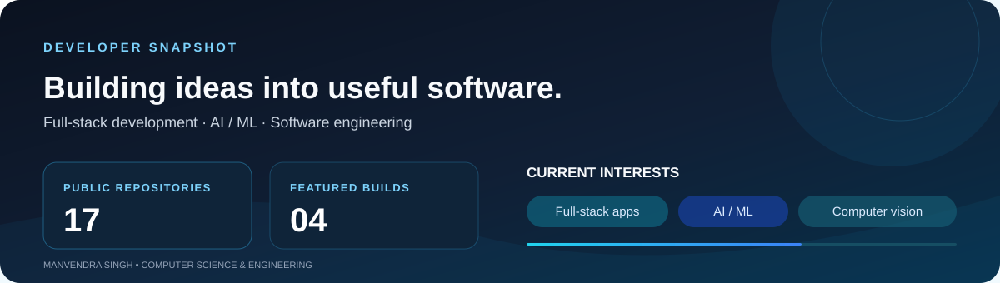

 

 
My personal avatar × SecuriTocat — curious, security-minded, and always building.

 

 

## 🌌 HD Visuals — Happy Roaming

 

Exploring ideas, discovering new paths, and enjoying the journey of building.

---

## 👋 A little about me

I'm **Manvendra Singh**, a Computer Science Engineering student interested in building practical software and exploring how intelligent, reliable applications are engineered.

I enjoy working across the stack—from responsive interfaces and backend APIs to data-driven features, testing, and collaborative development. I value learning by building, understanding the fundamentals behind tools, and improving projects through iteration.

- 🔭 **Building:** Full-stack applications and AI-powered platforms
- 🧠 **Exploring:** Applied machine learning, NLP, semantic search, and computer vision
- 🤝 **Collaborating:** Team-based engineering and open-source development
- 📚 **Improving:** Data structures, algorithms, system design, and core CS foundations
- 💬 **Topics:** Python, FastAPI, React, API design, and intelligent application workflows

> *Curiosity starts the build. Consistency ships it.*

---

## ⚙️ Technologies I work with

| **Languages** | **Frontend** | **Backend & Data** | **AI / ML** | **Tools** |
|:---:|:---:|:---:|:---:|:---:|
| Python · C · JavaScript · C# · SQL | React · Vite · HTML · CSS · Tailwind CSS | FastAPI · Node.js · REST APIs · SQLite · MongoDB | scikit-learn · Sentence Transformers · Pandas · NumPy · OpenCV | Git · GitHub · Linux · Postman · VS Code |

 

  

---

## 🚀 Featured build

<table>
<tr>
<td width="100%" valign="top">

<h3>🤖 <a href="https://github.com/manvendrasingh19/TechMatch-AI">TechMatch-AI</a></h3>

**AI resume intelligence & job matching**

A full-stack career platform that analyses resumes, compares them with job descriptions, and ranks opportunities using semantic similarity and skill matching.

- PDF/DOCX resume parsing and skill extraction
- Hybrid semantic + skill-match ranking
- Job listings from Adzuna and Remotive
- User accounts, preferences, and saved jobs

**Stack:** Python · FastAPI · React · Vite · Sentence Transformers · scikit-learn · SQLite

<a href="https://github.com/manvendrasingh19/TechMatch-AI/pulls?q=is%3Apr+is%3Amerged">View merged pull requests →</a>

</td>
</tr>
</table>

<strong>TechMatch-AI — application preview</strong>

 

---

## 📊 GitHub at a glance

> **Live profile data:** Explore the repositories and activity links above for the latest GitHub-side updates. External counters and streak services can be intermittently unavailable, so I keep the profile focused on reliable project and contribution signals.

---

## 🐍 Contribution journey

The contribution animation is generated by GitHub Actions and published to the `output` branch. The workflow runs on a schedule and can also be started manually.

*The animated contribution graphic is generated automatically by the profile repository's GitHub Actions workflow.*

---

## 🌱 What I'm focusing on

| 🧩 Problem solving | 🏗️ Software engineering | 🧠 Intelligent systems |
|:---:|:---:|:---:|
| Data Structures & Algorithms | Backend architecture | NLP & semantic search |
| Core CS foundations | Testing & clean code | Practical AI/ML |
| Consistent coding practice | Collaborative development | Computer vision |

---

## 🤝 Let's connect

I'm always glad to meet developers, exchange ideas, and collaborate on meaningful projects.

  

**Thanks for visiting!** ⭐  
*Keep learning · Keep building · Keep growing*

